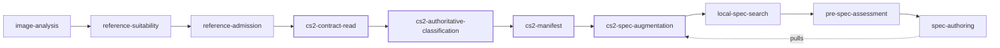

# plugin-cs2

Counter-Strike 2 weapon and glove skin reconstruction, as an [img2threejs](https://github.com/img2threejs/img2threejs)
plugin.

Without this plugin the base skill treats a CS2 skin as an ordinary hard-surface object and
reconstructs it by inference — which works, and is less exact. With it, the run gains an authoritative
intake contract, a machine-checked manifest, the finish and wear rulebook, and a blocking review gate:
none of which the base skill can improvise.

The base skill stays the entry point. **This plugin cannot run alone.**

## Install

```bash
img2 add img2threejs/plugin-cs2
img2 doctor                       # expect: ok (N plugins, 0 warnings)
```

Requires harness `>=0.2.1` and `coreApi 1`. Python 3.10+, standard library only for the required path.

## Use

Declare the domain on the state file:

```bash
--profile cs2
```

**It is never inferred from the target's name.** A target called `"AK-47 | Redline"` does not
self-identify, by design — name similarity is not evidence (`PLUGIN_CONTRACT.md` §13). The base skill
previously applied CS2's quality floors to anything whose name contained one of seventeen keywords,
`"fade"` among them, which is the failure this rule exists to prevent.

There is no `--cs2` flag. The base pulls this plugin's augmentation automatically once the domain
resolves.

The base may also select `profile:cs2@<resolvedSha>` through a recorded `routeDecision`.
This expresses profile intent, **not CS2 identity**: the independent authoritative classification
step still runs and can veto a look-alike, missing evidence, confidence below 0.82, or a timeout.
`route.json` declares a local `spec-augmentation` candidate; the augmentation is consumed inside
the base child, whose terminal output is a `3d-object`, not an augmentation handed to composition.
See the intake contract for the trusted-caller handoff and offline decision snapshots.

## What it contributes

Four setup steps spliced immediately **before** the base's `local-spec-search`, plus a scene producer
and per-pass review before `ai-review-recorded`. The terminal `plugin-gates` review remains blocking.

| Step | Actor | What it does |
|---|---|---|
| `cs2-contract-read` | agent | Read `grimoire/intake/cs2_intake_contract.md` **completely** before creating or validating the manifest. It is a contract, not a reference. |
| `cs2-authoritative-classification` | agent | Obtain an authoritative family/subtype record into `classification.json`. Guessing the subtype from the image is the failure this step exists to prevent. |
| `cs2-manifest` | program | Builds and validates `cs2-intake.json`. Records `componentAdapter` when this plugin has geometry for the family, or `geometrySource: agent-inferred` when it does not. |
| `cs2-spec-augmentation` | program | Emits `spec-augmentation.json` — the artifact the base **pulls** during spec authoring. |
| `cs2-review-scene` | program | Refreshes `cs2-review-scene.json` from the current validated manifest's scene policy before each pass; never grants terminal authority. |
| `cs2-review` | gate | Machine-readable verdict. **Blocking**: a failed verdict stops `continue` even when the global fidelity score passes. |

It also contributes the `cs2` evidence collection to the base's local spec search.



## Hard rules

- **Read the intake contract completely before the manifest.** A manifest authored without it is not
  admissible.
- **A failed `cs2-review` blocks continuation.** Do not proceed on a global score alone. The review is
  deliberately stricter than the general fidelity gate, because a wrong subtype or a wrong finish reads
  as a different item entirely.
- **Paint seed and float are not recoverable from an image.** Record pattern placement and wear as
  approximated, never as measured.
- **The subtype is authoritative or it is unknown.** A Talon has no crossguard; a Karambit does.
  Reporting a part as not-applicable is correct; inventing one is not.

## What ships

```
plugin.json                 typed capability edge: image -> cs2-skin-spec
domain.json                 the 4 setup steps, 1 pass step, their anchors, the corpus name
gates.json                  the blocking cs2-review gate
steps.json                  harness-level step rows
spec_search_profile.json    the cs2 evidence collection
SKILL.md                    what the model is told about this domain

grimoire/intake/            the intake contract, quality and identity, technical analysis,
                            texture acquisition
grimoire/build/             finish routes and the wear rulebook
docs/cs2/                   technical mapping and vocabulary
docs/cs2-anatomy/           per-family anatomy: knives, gloves, pistols, rifles, SMGs,
                            snipers, heavy
docs/specs/vocabulary/      distilled vocabulary records the corpus indexes
skills/                     per-subtype notes
```

### Tools

| Tool | Required? | What it does |
|---|---|---|
| `cs2_manifest.py` | yes | Builds and validates `cs2-intake.json` |
| `cs2_review.py` | yes | The blocking review gate |
| `cs2_measure.py` | diagnostics | Measures silhouettes from one reference-view capture and two distinct orbit captures, checking recorded hashes; does not authenticate producers or grant terminal approval |
| `emit_spec_augmentation.py` | yes | Emits the artifact the base pulls |
| `cs2_spec_template.py` | yes | The finish, material and component recipe |
| `cs2_adapters.py` | yes | Per-family geometry adapters |
| `cs2_foundation.py` | yes | Identity resolution: explicit → resolved → classification |
| `cs2_routing.py` | routed entry | Checks the base caller's route digest, object, reference and provider pin; never classifies |
| `cs2_decision_adapter.py` | decision inputs | Hash-checks current evidence and exposes bounded plans/repairs without consulting a provider |
| `cs2_review_contract.py` | yes | Review scene and the golden thresholds |
| `cs2_terminal.py` | terminal producer/replay | Computes artifact-bound measurements from approved source regions and matched-light observations; invokes only the program-owned base host |
| `detect_cs2.py` | no | Heuristic detection, for triage only — never for routing |
| `locate_cs2_vpk.py` | no | Finds a local CS2 install's `pak01_dir.vpk` |
| `extract_cs2_textures.py` | no | Extracts authored paint textures from **your own** install |
| `fetch_cs2_metadata.py` | no | Resolves paint index, float range, rarity from the CSGO-API index |

The optional four are **exactness upgrades**. Every one degrades gracefully: a missing VPK, a missing
extractor binary, a subprocess error or a non-zero exit all return `{"status": "fallback", "reason": …}`
so the pipeline falls back to the image-only path rather than producing a wrong answer. See
[SECURITY.md](SECURITY.md) before using them.

`cs2_measure.py --workspace CHILD --intake cs2-intake.json --classification classification.json
--artifact artifact.json --capture reference/capture.json --capture orbit-left/capture.json
--capture orbit-right/capture.json` writes diagnostic JSON to stdout. The first capture is the
reference view. Paths are relative to the child workspace; capture records and the reference image
must already exist. Capture, config and renderer report must agree on camera, viewport, frame and
delivery digest. These consistency checks do not authenticate the renderer. Identical pixels do not
prove or disprove capture authenticity; measurements do not replace terminal-authority gates.

### Production terminal handoff

The base calls `produce_terminal(workspace, inputs=..., host=...)` from
`tools/cs2_terminal.py`. It does not import the base implementation or launch a
plugin-selected privileged command. The host is an actual program-owned object:

```python
host.verify_classification(workspace, *, classification, reference, intake, artifact)
host.verify_sources(workspace, *, sources, context)
host.capture(workspace, *, artifact, delivery, config, output_dir)  # returns {path, sha256}
host.verify_quality(workspace, *, context)
```

Verification methods raise on refusal. They must authenticate exact current evidence,
not accept a JSON provider string or a self-hashed renderer report. `capture` invokes
the base's fixed `capture_delivered_glb` producer with independently approved Chrome
and Three module pins. `verify_quality` must consume journal-authenticated review of
the same artifact, source, cameras, captures, annotated regions, metrics and frozen
thresholds. A callable or a stored `host-reviewed` string alone is not authority;
the parent independently revalidates that boundary before accepting a child.

`inputs` contains `intake`, `classification`, `artifact`, `delivery`, `sources`
bindings, each exactly `{path, sha256}`, three ordered `configs` bindings (reference,
orbit-left, orbit-right), and `passId`. All paths are child-workspace relative.
Production always captures afresh; replay additionally requires `captures` (three
capture-record bindings) and `materialCaptures` in source-observation order.

The bound `sources` JSON contains:

- `reference`: the exact current intake image binding.
- Nonempty `regions` and `criticalFeatures`: independently approved annotations,
  each `{id, bounds: [left, top, right, bottom]}` in normalized image coordinates.
  These are real named source observations, not automatically invented colour bins.
- `materialViews`: at least two `{source: binding, config: binding}` observations
  of the real source under distinct known lighting states. Camera, transform,
  viewport, background and frame must match the reference capture configuration.
  The host must approve source provenance and calibration; generated GLB renders
  are not independent source measurements.

The producer measures silhouette/proportions, annotated RGB agreement and coverage,
local feature luminance correlation, orbit subject-area ratios, and material
RGB response across matched lighting states. The material score is the minimum
region score across lighting pairs: normalized RGB-delta agreement, absolute RGB
agreement and rendered coverage. Source response below two RGB levels is
unmeasurable, never a passing default. Pixel equality is legitimate and is not
rejected as capture fraud. Structural resemblance **does not establish asset
identity**, nor do these RGB measurements recover float, paint seed or physical
roughness. Authenticated classification and semantic review remain required.

Missing source observations, annotations or config fields produce named refusals;
there is no prose/confidence fallback. A single arbitrary reference cannot establish
material response. Failed measured thresholds remain failures.

Default output is `.img2/cs2-terminal/{inputs,metrics,scene,report,context}.json`,
plus `handoff.json` only after strict measurements and host review. This handoff
references the existing base D18 artifact; it neither replaces it nor grants
parent terminal authorization. A rejected run retains its failed report.
Production requires a fresh output directory. If journal review is not yet available,
the exact captures and context remain available after the host refuses review.
Consult the shared controller against that saved context outside the parent
transaction, then call `finalize_terminal(workspace, inputs=persisted_inputs,
host=host, output_dir=...)`. Finalization reauthenticates and replays existing
evidence without recapturing or changing the reviewed subject.
The blocking gate replays these workspace inputs and scene instead of a bundled
knife fixture. Independent pinned-input replay:

```sh
python3 PLUGIN/tools/cs2_terminal.py --workspace CHILD \
  --inputs .img2/cs2-terminal/inputs.json --inputs-sha256 INPUTS_SHA256
python3 PLUGIN/tools/cs2_review.py --workspace CHILD \
  --terminal-inputs .img2/cs2-terminal/inputs.json \
  --scene .img2/cs2-terminal/scene.json --out CHILD/cs2-review.json
```

Replay exit zero means measured gates passed, not authenticated terminal approval.
Real smoke prerequisites are a valid self-contained delivered GLB, approved host
Chrome/Three pins, calibrated source/config observations, approved region/feature
annotations, authoritative classification provenance and a current authenticated
quality-review record. Synthetic unit fixtures supply none of that authority.


### Geometry coverage

| Family | Adapter | Subtypes |
|---|---|---|
| knife | yes | karambit, butterfly, bayonet, m9, flip, gut, falchion, bowie, navaja, talon, classic |
| pistol | yes | glock-18 |
| rifle, SMG, sniper, heavy, gloves | no | reconstructed as `geometrySource: agent-inferred`, using the anatomy pages in `docs/cs2-anatomy/` |

A family without an adapter is **not** unsupported — it records its geometry source honestly and the
rest of the contract still applies.

## Customising it

Everything below is a change to *this* repo. None of it can weaken the base skill: the augmentation
merge is raise-only, and a plugin cannot remove a base gate.

### Add a subtype to a family that already has an adapter

`tools/cs2_adapters.py` → add to `SUPPORTED_KNIFE_SUBTYPES` (or the pistol set). Add its anatomy to
`docs/cs2-anatomy/<family>.md` in the same shape as the existing entries — the anatomy page is what
tells the run which parts a subtype does and does not have, and "not applicable" is a valid answer.

### Add a whole new family adapter

`tools/cs2_adapters.py` → build a `FamilyAdapter` (topology, painted regions, material assignments,
feature targets, attachment rules, review viewpoints) and register it in `_ADAPTERS`. Until you do, the
family falls back to `agent-inferred`, which is a working path — so do this when inference is
measurably not good enough, not preemptively.

### Tune the review thresholds

`tools/cs2_review_contract.py` keeps the legacy projection recipe's `GOLDEN_THRESHOLDS`
separate from `TERMINAL_THRESHOLDS`, the exact program-owned review policy. Both scene-file
loading and direct evaluation reject missing/extra keys, changed values, booleans, strings,
and non-finite thresholds. Editing a scene cannot lower or raise that policy.

The domain scene producer translates the current manifest's validated `reviewScene`
camera, transform and environment into the per-pass evaluator schema; it does not load
the historical test fixture or authenticate a renderer. Missing/invalid source policy
fails before publishing a scene. Terminal review still reconstructs its scene from captures.

### Change where the steps land in the pipeline

`domain.json` → `setupAnchorBefore` and `passAnchorBefore` name **base** step ids, and your steps
splice immediately before them. The current anchors are chosen so the manifest can read
`admission.json` and `probe.json` (which exist after `reference-admission`) and so `spec-authoring` can
pull `spec-augmentation.json`. An anchor naming a base step that does not exist fails loud rather than
appending at the end.

### Change what the augmentation raises

`tools/emit_spec_augmentation.py`. The merge is executed by base code and is **raise-only**: a number
below the base value is clamped and the attempt recorded; a looser strictness tier is ignored; an
unknown key is refused. You cannot lower a base floor from here, by design.

### Add reference material to the corpus

Drop it under `docs/cs2/` or `docs/cs2-anatomy/` — both are already `optional_source_roots` in
`spec_search_profile.json`. Distilled records go in `docs/specs/vocabulary/*.jsonl`.

## Tests

```bash
python3 scripts/test_synthetic.py                    # fictional, fixture-independent subset; isolated HOME
python3 -m unittest discover -s tests -p 'test_*.py'  # original full gate; includes historical fixtures
```

The suite runs **standalone** — it does not need the base skill's test tree. It includes
`test_cs2_oracle_replay.py`, a byte-equality replay of a completed Talon reconstruction
(`tests/fixtures/oracle-talon/`) that fails if the review output drifts by a single byte, and
`test_suite_integrity.py`, which asserts the collected count against a recorded floor — a single
indentation error once silently dropped three tests here, and only counting caught it.

The synthetic subset physically excludes `tests/fixtures/` from its temporary source
snapshot. CI runs this subset on Python 3.10 and 3.12, including the literal expanded
domain pass commands and declared terminal gate with synthetic captures. It is **not**
the full historical baseline or authenticated host/render evidence. Historical fixture
provenance and the full gate remain unverified under the fictional/nonfunctional-only
restriction; tests and the full-suite count floor are retained, not disabled.

Plugin source declares version **0.2.0**; no tag, publication or installer pin is implied.
The terminal gate declaration remains unchanged because core pins its exact argv.
Non-routed trusted-host production and routed run-specific paths still require the
coordinated core contract update; a local authored-metrics fallback is not allowed.

## Limits

- Paint seed and float **cannot** be recovered from an image. They are approximated and must be
  reported as such.
- `detect_cs2.py` is triage only. Declared or base-validated routed profile intent never replaces authoritative classification.
- The optional exactness tools need your own legal CS2 install and, for texture extraction, a
  Source2Viewer-CLI binary you supply.

## License

Apache-2.0 — see [LICENSE](LICENSE).

Counter-Strike 2 and all related marks and assets are the property of Valve Corporation. This plugin
ships **no** game assets; see [SECURITY.md](SECURITY.md).
